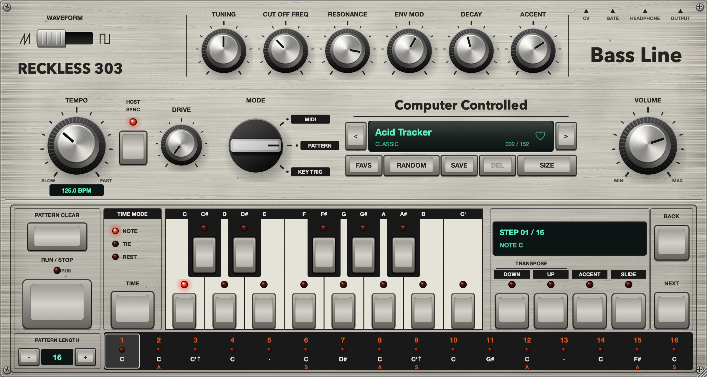

# Reckless303

A TB-303 style bassline synthesizer and step sequencer, as **VST3**, **AU** and **Standalone**, built with [JUCE 8](https://juce.com).



> Independent emulation inspired by the Roland TB-303 Bass Line. Not affiliated with or endorsed by Roland Corporation.

## Features

**Sound engine** (modelled after the TB-303 block diagram and spec sheet)
- VCO: sawtooth or square (the 303's slightly asymmetric square), band-limited (polyBLEP)
- VCF: 4-pole 24 dB/oct ladder with a highpass in the resonance loop, 2x oversampled, soft-saturating
- Controls: **Tuning** (±12 st), **Cut Off Freq**, **Resonance**, **Env Mod**, **Decay** (200 ms – 2 s), **Accent**
- Accent shortens the filter envelope and charges an "accent capacitor" that builds up over consecutive accents (the classic wow)
- Slide: constant-time portamento (~60 ms) without envelope retrigger
- Extra: **Drive** (overdrive) and **Volume**

**Sequencer**
- 16 steps, 1–16 step length, per step: note (C..C'), **UP/DOWN** octave, **ACCENT**, **SLIDE**, time mode **NOTE / TIE / REST**
- Synced to the host transport, or free-running with the **TEMPO** knob and **RUN/STOP**
- **MODE** switch: `MIDI` (play it from a keyboard; legato = slide, velocity ≥ 100 = accent), `PATTERN` (sequencer, incoming notes transpose it from C3), `KEY TRIG` (pattern plays while a key is held, transposed)
- Right-click the step strip: set length, shift, randomize, clear, copy/paste pattern as text

**Presets**
- **152 factory presets**: 52 hand-programmed (Classic, Squelch, Bass, Lead, Dark, Distorted) + 100 generated
- **RANDOM**: generate a new sound + pattern (sound-only / pattern-only from the preset menu)
- **SAVE** / **DEL** user presets (`~/Library/Application Support/Reckless303/Presets/*.reckless303`, plain XML)
- **Like** (heart) any preset, browse liked only with **FAVS**, or open the *Liked* submenu

**Interface**
- Resizable from 50 % to 200 % (drag the corner or use **SIZE**), fully vector, remembered per session
- 3D machined knobs, rubber key caps, LEDs, procedurally generated brushed, lightly scratched and worn aluminium case

## Install (macOS)

Build from source (below); the build copies the plugins to
`~/Library/Audio/Plug-Ins/VST3/Reckless303.vst3` and `~/Library/Audio/Plug-Ins/Components/Reckless303.component`.

CI builds (macOS universal + Windows VST3) are attached to each GitHub Actions run as artifacts.
They are unsigned: on macOS run `xattr -dr com.apple.quarantine <plugin>` after copying.

## Build

Requirements: CMake ≥ 3.22, a C++17 compiler (Xcode / Command Line Tools on macOS, MSVC on Windows).

```bash
git clone --recursive https://github.com/RecklessBoise/Reckless303.git
cd Reckless303
cmake -B build -DCMAKE_BUILD_TYPE=Release
cmake --build build --config Release
```

Universal macOS binary: add `-DCMAKE_OSX_ARCHITECTURES="arm64;x86_64"`.

Offline check tool (UI snapshot + audio render, no host needed):

```bash
cmake -B build -DRECKLESS303_BUILD_TOOLS=ON
cmake --build build --target Reckless303RenderTool
build/Reckless303RenderTool_artefacts/Release/Reckless303RenderTool out
```

## Pattern text format

Patterns are stored as 1–16 space-separated tokens: `C`…`B`, `C'` (high C), `-` rest, `_` tie,
followed by flags `u` (up), `d` (down), `a` (accent), `s` (slide). Example:

```
C Ca C'u C - Cs D# Ca C'us C G# Ca - C F#a Cs
```

## License

AGPL-3.0 (as required by JUCE's open-source license). See [LICENSE](LICENSE).
